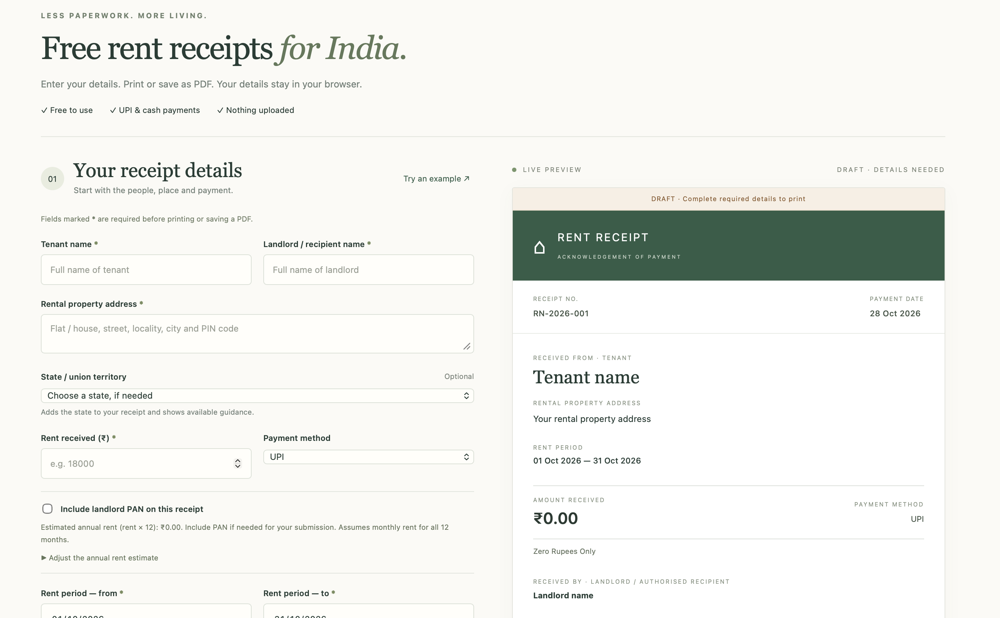

[**Create your rent receipt →**](https://madras-forge.github.io/rent-receipt-generator-india/)

[https://madras-forge.github.io/rent-receipt-generator-india/](https://madras-forge.github.io/rent-receipt-generator-india/)

# Rent Receipt Generator – India

Enter common details once, choose rent months, review each payment and save one PDF.

**Disclaimer:** This is a general receipt, not legal or tax advice or a prescribed statutory form.

## Why this tool exists

Millions of Indian salaried tenants need rent receipts every year for HRA claims. Most existing tools are ad-heavy, ask for sign-ups, or upload your data. This tool is free, private, and runs in the browser.

## Features

- Indian currency formatting and amounts in words
- UPI, bank transfer, cash and cheque payments
- PAN format checks, automatic suggestions and opt-out
- Signature line, optional stamp space and next-month receipts
- Single receipts or multiple reviewed months in one PDF
- Suggested filenames such as `Rent_Receipt_Oct26.pdf` and `Rent_Receipt_Apr26-Mar27.pdf`

## Screenshot



## Run locally

1. Download or clone the repository.
2. Open `index.html` in a browser (`dist/index.html` in the authoring checkout).

No installation, server or build step is needed.

## Usage

1. Enter the tenant, landlord and property details once.
2. Choose **One receipt** or **Multiple months**. For multiple months, select the financial year and months to include.
3. Enter each actual payment date, check the amount, method and receipt number, then confirm each payment. Editing a payment clears its confirmation.
4. Review the PAN suggestion and preview. Complete required fields, then select **Print / Save PDF** and choose **Save as PDF** in the browser's print window.

Selected months print in calendar order in one document. The suggested filename uses the first and last rent months, including when you select months with gaps. Your browser controls the final save name and print settings.

## Tax and PAN guidance

**Last verified: 2026-10-28**

- For employer/HRA documentation, landlord PAN is required when actual annual rent exceeds ₹1,00,000. [Official guidance](https://www.incometaxindia.gov.in/documents/d/guest/form-124-faqs)
- The automatic suggestion uses rent × 12 for one receipt, or the entered monthly average × 12 for multiple months. Adjust the annual total if needed; opting out does not waive employer requirements.
- PAN checks cover structure only, not issuance, the final check letter or ownership. [PAN structure guidance](https://www.incometaxindia.gov.in/documents/d/guest/1-permanent-account-number-pan-pdf)

## Privacy

Form details stay in the page's memory. No uploads, analytics or saved drafts. Refreshing or closing the page clears the form. Keep real personal data out of screenshots, issues and pull requests.

Saved PDFs contain the details you entered; store and share them carefully.

## Hosting

Upload `index.html`, `style.css`, `receipt-utils.js` and `app.js` to the GitHub repository root. These four files are in `dist/` in the authoring checkout. Keep the existing `docs/screenshot.png` image.

Under **Settings → Pages**, choose **Deploy from a branch → main → / (root)** and save.

## Contributing

First-time contributors are welcome. Open an issue or submit a focused pull request describing your change and how you checked it. Include official sources for changes to tax or state guidance.

The code is split into page structure (`index.html`), styles (`style.css`), calendar/money/filename helpers (`receipt-utils.js`) and form/preview/print behaviour (`app.js`). Comments explain the main decisions.

Optional developer checks require Node.js, with no packages to install:

```sh
node --test tests/receipt-utils.test.cjs
```

## Roadmap

- Expand verified state-specific guidance
- Add keyboard and screen-reader checks for the monthly review flow
- Improve accessibility and add Indian-language interfaces

## Limitations

- State-specific guidance is incomplete; check applicable requirements.
- The tool does not verify payments, identities or signatures, or calculate HRA eligibility.
- A stamp box is only a placeholder and does not pay stamp duty.
- Review the PDF or print preview before use.
